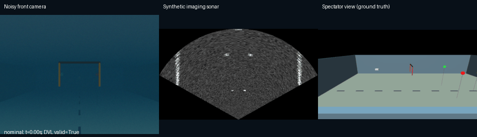
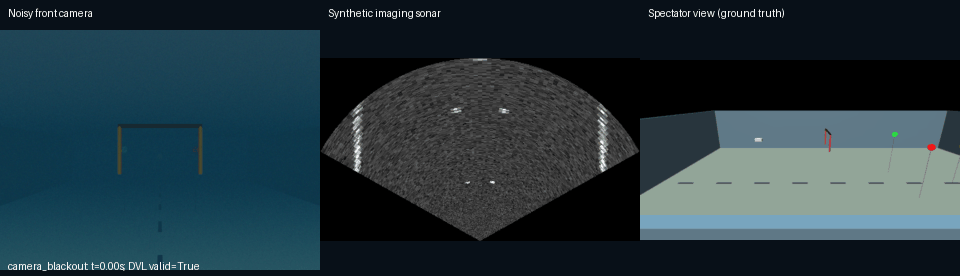

# MuJoCo Marine Sim

A configurable underwater robot simulator for testing vehicle dynamics, simulated sensors, sensor failures and perception data generation in a repeatable pool environment.

The project models an autonomous underwater vehicle (AUV) in MuJoCo, adds underwater forces and sensor effects, and records what the vehicle observes alongside simulation ground truth. It supports experiments such as losing DVL bottom lock, degrading camera visibility, injecting a false sonar target, or generating labeled images of gates and buoys.

This simulator was developed within [Agentic AUV](https://github.com/MadLad10/Agentic-AUV-multimodal-multi-agent-autonomy-for-an-underwater-robot) and extracted into an installable Python package. It runs independently of the parent application's ROS 2 nodes, mission agents, navigation models and detector weights.

## Simulation preview





The panels show the noisy front camera, synthetic imaging sonar and a noiseless spectator view. These recordings use zero motor commands: the vehicle rises under buoyancy while scheduled faults change its sensor outputs. [View all four recordings and their settings](docs/DEMOS.md).

## What we built

1. **Underwater vehicle dynamics.** A rigid body with six thrusters, thrust saturation and first-order actuator lag. Custom forces add buoyancy, a restoring moment from the center-of-mass offset, linear/quadratic drag and drag relative to a configurable water current.
2. **A simulated sensor suite.** Camera, sonar, velocity, inertial, heading, depth and vehicle-health measurements with configurable noise and sampling rates. Camera appearance includes distance-dependent color attenuation, water-color blending and pixel noise; sonar combines geometric echoes with synthetic image noise.
3. **Scheduled fault injection.** Eleven fault types with configurable start times, optional durations, parameters and an onset/clear event log. The simulator applies faults to the relevant measurement or actuator model.
4. **Ground-truth annotation and evaluation.** Camera segmentation supplies visibility-filtered YOLO bounding boxes. Sonar echoes supply image-space annotation boxes. A referee records gate crossings, buoy touches, surfacing, collisions and boundary events, and can score externally supplied position estimates.
5. **A standalone distribution.** Packaged YAML resources, a `marine-sim` CLI, a Python example, regression tests, wheel installation checks and a GitHub Actions workflow. We also recorded nominal, turbidity, camera-blackout and DVL-dropout demonstrations with their seeds and timestamps.

The dynamics, sensor, fault, annotation and referee implementations come from the original simulator component. The extraction adds standalone packaging, portable configuration lookup, the CLI and release documentation. [Source provenance and extraction details](docs/EXTRACTION.md).

## Technology stack

| Technology | Role in this project |
|---|---|
| Python 3.10+ | Simulator implementation, API, CLI and dataset generation |
| MuJoCo 3.x | Rigid-body integration, collision/contact queries, ray casting, RGB/depth/segmentation rendering |
| NumPy | Coordinate transforms, force calculations, seeded noise and image/sensor arrays |
| PyYAML | Vehicle, sensor, arena and fault-schedule configuration |
| Pillow | Dataset image export, demo panels, PNG screenshots and GIF recordings |
| EGL / OpenGL | Offscreen camera and demonstration rendering used in local verification |
| OSMesa | Software-rendering backend configured for the CI container |
| setuptools / wheel | Installable Python wheel and source distribution |
| pytest / GitHub Actions | Local regression checks and the configured CI workflow |

Runtime dependencies are MuJoCo, NumPy, PyYAML and Pillow. Supported ranges are declared in [pyproject.toml](pyproject.toml); the [verification receipt](docs/verification.json) records the exact versions exercised locally.

## Sensor stack

All entries below are software sensor models. Defaults come from [sim.yaml](src/auv_marine_sim/config/sim.yaml); measurement construction and sampling are implemented in [sim.py](src/auv_marine_sim/sim.py).

| Sensor / telemetry | Output and default configuration | Noise, limitations or failure behavior |
|---|---|---|
| Front RGB camera | 640 × 480 RGB, 80° horizontal field of view, 9 m visibility parameter; rendered on request through `camera_image()` | Range-dependent, per-channel attenuation and water-color blending; pixel noise; turbidity and black-frame faults |
| Forward-looking imaging sonar | 2 Hz scans, 120° horizontal field of view, 81 azimuth beams across five elevation samples, 15 m maximum range; `sonar_image()` produces a 448 × 256 fan image with 256 range bins | 0.05 m range-noise standard deviation, missed returns, image speckle/noise; dropout and false-target faults |
| Doppler velocity log (DVL) | 5 Hz body-frame ground velocity, altitude and validity flag; four bottom-track rays at 30°, 30 m maximum ray range, 0.3 m minimum altitude | 0.01 m/s velocity-noise standard deviation and 0.2% scale error; invalid output when bottom-lock conditions fail or dropout is injected |
| Inertial measurement unit (IMU) | 20 Hz angular velocity, acceleration, roll and pitch | Gyro/accelerometer noise, gyro bias random walk, attitude noise and an injected gyro-z bias step |
| Compass | 10 Hz yaw in radians | 1.5° heading-noise standard deviation; magnetic-disturbance offset fault |
| Pressure / depth sensor | 10 Hz depth in meters, positive downward from the water surface | 0.005 m depth-noise standard deviation; a stuck sensor holds its last depth reading |
| Battery monitor | 1 Hz remaining charge, modeled voltage and power; default 20 Wh capacity | Energy use depends on hotel load and thrust; a battery-drop fault removes stored energy |
| Thruster telemetry | 10 Hz thruster names, requested thrust, lagged thrust and modeled current | Current-measurement noise; a dead-thruster fault removes that actuator's drive |
| Leak sensor | 1 Hz Boolean leak state | A scheduled leak fault raises the indication |

The default physics step is **0.005 s (200 Hz)**, with sensor scheduling and simulation updates on a **0.05 s (20 Hz)** tick. Each sampled sensor retains its own timestamp. Camera rendering is on demand; recording a GIF at 10 frames/s does not increase the sonar's 2 Hz ping rate. Ground-truth segmentation and spectator cameras are available separately for annotation and visualization.

## Vehicle and environment

The default vehicle is a 0.5 × 0.3 × 0.2 m box hull with a mass of 29.7 kg. At the configured water density of 1000 kg/m³, it has slight positive buoyancy. Its center of mass sits 0.04 m below the body origin, which provides a restoring moment. Six thrusters form surge, heave and sway pairs; each has a ±40 N command limit and a 0.1 s thrust-lag time constant.

The bundled arena contains a **30 × 20 × 5 m pool**, floor lane markers, a gate and red, green and yellow buoys. Two layouts are included: [default](src/auv_marine_sim/config/arenas/default.yaml) and [buoy_hidden](src/auv_marine_sim/config/arenas/buoy_hidden.yaml). Arena YAML defines object positions, dimensions and the vehicle's starting pose. The world frame uses z upward, with z = 0 at the water surface and depth = −z.

Vehicle parameters, current, sensor settings and appearance are configurable through YAML. Arenas can be selected by their packaged name or by an explicit file path. The dataset generator additionally randomizes object layout, camera pose, visibility, water color and pixel noise.

## Supported faults

| Fault identifier | Effect |
|---|---|
| `camera_blackout` | Front camera returns black frames |
| `turbidity` | Reduces the camera visibility parameter |
| `dvl_dropout` | DVL reports invalid velocity |
| `imu_bias` | Adds a gyro-z bias |
| `compass_disturbance` | Adds a heading offset |
| `pressure_stuck` | Freezes the depth reading |
| `sonar_false_target` | Inserts a phantom sonar return at a configured position |
| `sonar_dropout` | Sonar reports no valid ping |
| `thruster_dead` | Disables the drive of a named thruster |
| `leak` | Raises the leak indication |
| `battery_drop` | Removes a configured percentage of battery capacity from stored energy |

Fault schedules use `type`, `t_start`, optional `duration` and a `params` mapping. See [the example schedule](examples/fault_schedule.yaml). A duration can end the active fault interval; a battery energy loss remains after its event.

## Installation

Python 3.10 or newer. A rendering backend is needed for camera images and the visual demos. The package was exercised on Linux; see [rendering](#rendering) for backend choices.

Using uv:

```bash
uv venv --python python3 .venv
source .venv/bin/activate
uv pip install -e ".[dev]"
```

Or, with Python's venv/pip where available:

```bash
python3 -m venv .venv
source .venv/bin/activate
python -m pip install -e ".[dev]"
```

## Quick start

List the available faults and inspect the default configuration:

```bash
marine-sim faults
marine-sim config
```

Run a short physics/sensor rollout:

```bash
marine-sim run --seconds 3 --seed 0 --output runs/nominal
marine-sim run --seconds 3 --seed 0 \
  --faults examples/fault_schedule.yaml --output runs/faults
```

Each run saves `sensors.jsonl`, `sim_config.json`, `arena.json` and `summary.json`. Sensor records exclude private annotation fields; the `truth` field and referee summary are explicitly ground truth. These commands let the buoyant vehicle drift with zero motor commands. Choose an empty output directory for each run.

Record the four visual scenarios:

```bash
MUJOCO_GL=egl marine-sim demo --seconds 2 --fps 10 --output runs/demo
```

This saves nominal, turbidity, camera-blackout and DVL-dropout GIFs, raw initial/final camera PNGs, a final sonar PNG and per-scenario JSON summaries. The seed, fault schedule and actual simulation timestamps are saved in `manifest.json`.

## Python API

```python
import os
os.environ.setdefault("MUJOCO_GL", "disable")  # physics/sensors, no camera rendering

from auv_marine_sim import MarineSim

sim = MarineSim("default", seed=7, faults=[
    {"type": "dvl_dropout", "t_start": 0.5},
])
try:
    sim.run_for(1.0)
    print(sim.readings["dvl"]["valid"])
    print(sim.referee.report())
finally:
    sim.close()
```

The library exposes the underlying MuJoCo model/data for simulation experiments. In the integrated AUV application, the deterministic onboard controller issues motor commands. The standalone CLI examples use passive rollouts. [Minimal API example](examples/basic.py).

## Automatic camera labels

The generator exports RGB images and normalized YOLO-format bounding boxes for `gate`, `red_buoy`, `green_buoy` and `yellow_buoy`. Boxes come from rendered object segmentation, filtered by minimum visible pixels, box size and estimated light transmission. Train/validation splits are assigned by scene.

```bash
MUJOCO_GL=egl python -m auv_marine_sim.autolabel \
  --out runs/tiny_dataset --scenes 5 --frames 4 --seed 0
```

The generated images, labels, `data.yaml` and `stats.json` remain local under `runs/`. These are synthetic annotations for training and evaluation; the generator does not train a detector. Sonar image annotations are available through the Python `sonar_image()` API.

## Evaluation outputs

The referee uses simulated vehicle position, object geometry and contact events to record gate passes/misses, buoy touch order, surfacing, collisions, boundary contacts, path length and final position. If an external estimator supplies position estimates through `record_estimate()`, it also reports horizontal and depth localization errors.

Fault logs record onset/clear events, while run summaries preserve the requested schedule, seed and simulator version. Sensor observations and explicit truth records can then be used to evaluate a separate navigation, perception or health-monitoring system.

## Rendering

- `MUJOCO_GL=egl`: offscreen rendering with a working EGL/OpenGL driver; used for the local visual checks.
- `MUJOCO_GL=osmesa` and `PYOPENGL_PLATFORM=osmesa`: software rendering when the operating system provides OSMesa; configured for CI.
- Physics-only CLI runs default to `MUJOCO_GL=disable` when no backend is already selected.

Set the backend before importing MuJoCo. This repository does not install system graphics drivers. The CI workflow provisions its own container graphics libraries.

## Tests and wheel verification

```bash
MUJOCO_GL=egl python -m pytest -q
uv build
```

The latest recorded local verification passed **27 tests**, including a second run against a wheel installed in an isolated environment outside the source directory. Tests cover dynamics, sensor payloads, all fault types, referee events, sonar annotations, seeded rollouts, CLI behavior, automatic camera labels and packaged configuration lookup. Four GIFs containing 84 recorded frames were also decoded and checked.

The [local verification receipt](docs/verification.json) records the tested versions and artifacts. The [GitHub Actions workflow](.github/workflows/tests.yml) is configured for Python 3.10 and 3.12 with OSMesa; remote CI execution has not been verified in that receipt.

## Repository layout

```text
src/auv_marine_sim/
  sim.py               vehicle dynamics, sensor sampling and rendering
  world.py             YAML loading and MuJoCo world construction
  faults.py            scheduled failures and onset/clear log
  sonar_image.py       synthetic sonar fan images and annotations
  autolabel.py         segmentation-based camera dataset generation
  referee.py           ground-truth events and localization metrics
  cli.py               configuration, rollout and demo commands
  config/              vehicle/sensor settings and bundled arenas
examples/              minimal API example and fault schedule
tests/                 simulator, labeling and standalone CLI tests
docs/                  provenance, verification and recorded media
.github/workflows/     package/test workflow
```

## Model limits

Hydrodynamics use a simplified buoyancy and damping model, without added-mass coupling or CFD. Sonar uses geometric ray/segment echoes and a synthetic intensity/speckle model, without full acoustic multipath. Camera appearance uses range-dependent attenuation and water-color blending rather than a calibrated underwater optical renderer. Sensor parameters have not been fitted to physical hardware.

The passive demos establish simulator behavior and fault injection; they do not evaluate autonomous navigation, mission success or transfer to a real vehicle.

## License

MIT. External dependencies retain their respective licenses.
